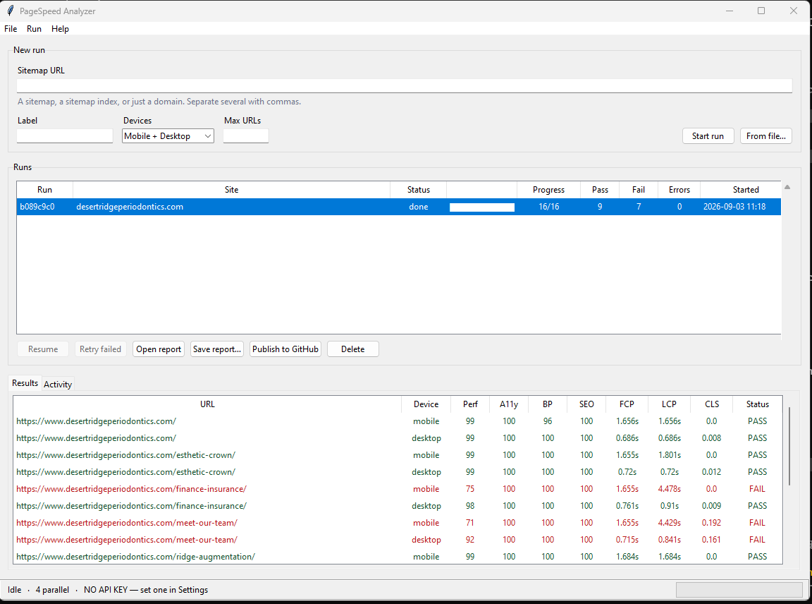

# PageSpeed Sitemap Analyzer

Runs Google PageSpeed Insights across every URL in a sitemap, for mobile and
desktop, and produces a pass/fail report.

Version 2 is a Python tool. The original single-file browser version is still
here as `index.html`, but it kept all state in a JavaScript array: closing the
tab, a dropped connection or a power cut lost the whole run, and a URL that
failed for a transient reason was recorded permanently as a score of zero.

This version fixes those specific problems:

- **Resumable.** Every test result is committed to SQLite the moment it
  finishes. Kill the process, lose power, close the laptop — `psi resume`
  continues from exactly where it stopped and re-tests nothing.
- **Auto-retrying.** Transient failures go back in the queue with exponential
  backoff instead of being written down as a failure.
- **Survives outages.** If the internet drops, the run pauses and waits rather
  than burning through every URL's retry budget, then resumes on its own.
- **Runs several sites at once**, sharing one rate limiter so their combined
  request rate stays inside the API quota.
- **No CORS proxies.** Running server-side, sitemaps are fetched directly —
  including gzipped sitemaps and nested sitemap index files.

There are three ways to drive it: a **desktop app**, a **browser dashboard**, and
a **command line**. All three share the same engine and the same database, so
you can start a run in the app and finish it from the terminal.

No dependencies beyond the Python standard library (3.10+).

---

## The desktop app

```bash
psi gui
```

Or just **double-click `psi-gui.pyw`** — no terminal, no browser. Right-click it
and choose *Send to → Desktop (create shortcut)* to keep it handy.



- **New run** — paste a sitemap URL and press Start. It accepts a sitemap, a
  sitemap index, or a bare domain (it will find the sitemap via robots.txt).
  Several comma-separated sitemaps start one run each. *From file…* loads a
  list of URLs or sitemaps from a text file.
- **Runs** — every run with live progress, pass/fail counts and status. Select
  one to see its results below; double-click to open its report.
- **Buttons** — Resume, Stop, Retry failed, Open report, Save report, Publish to
  GitHub, Delete. They enable and disable to match what the selected run can
  actually do.
- **Stop** — halts the selected run without losing anything. No new tests start,
  tests already sent to Google are allowed to land, and the run goes to
  *paused*, so Resume picks up from exactly there. *Run → Stop everything* does
  the same for every run at once; either way the app stays usable afterwards.
- **Results** — sortable table of every test in the run, colour-coded: **PASS**,
  **FAIL**, **ERROR** (the test itself could not run — shown with dashes rather
  than a misleading score of 0), **TESTING** and **QUEUED** for work still to
  come. The *Show* dropdown filters by any of those. Double-click a row to open
  it on pagespeed.web.dev.
- **Retry selected** — re-test individual rows instead of the whole run. Pick
  one row, or Ctrl/Shift-click several, and press *Retry selected* (or
  right-click for the same menu plus Copy URL and Details). Those tests go back
  on the queue and start immediately; everything else is left alone. Works on a
  run that is already going, and on one that finished days ago.
- **Activity** — a live log of what the engine is doing, including retries and
  connection problems.
- **File → Settings** — API key, GitHub credentials, parallelism and pass
  criteria, all without editing a config file.

If the app is closed mid-run — or the machine loses power — it offers to resume
everything outstanding next time it opens.

### Browser dashboard

If you would rather work in a browser, `psi serve` gives you the same thing at
`http://localhost:8787`.

---

## Install

```bash
pip install -e .      # gives you a global `psi` command
```

Or skip installing and use `python -m psi ...` (on Windows, `psi.cmd` in this
folder does the same thing).

Set your API key once — get a free one from
[Google](https://developers.google.com/speed/docs/insights/v5/get-started):

```bash
psi config --api-key YOUR_KEY
```

It is written to `~/.psi/config.json`, outside this git repository. You can use
the `PSI_API_KEY` environment variable instead.

---

## Use

```bash
# Analyse a sitemap and open the report when it finishes
psi run --sitemap https://example.com/page-sitemap.xml --open

# Several sites at once, each with its own report
psi run --batch sites.txt

# Continue anything that was interrupted
psi resume --all

# Re-queue tests that were given up on
psi retry a3f9c1

# Point-and-click dashboard at http://localhost:8787
psi serve
```

### Commands

| Command | What it does |
| --- | --- |
| `psi run` | Start a new analysis from `--sitemap`, `--urls` or `--batch` |
| `psi resume [ID…] \| --all` | Continue interrupted runs |
| `psi retry ID` | Re-queue tests that exhausted their attempts |
| `psi list` | Recent runs and their progress |
| `psi status ID` | Detail for one run, including why tests failed |
| `psi report ID` | Write HTML/CSV/JSON for an existing run |
| `psi gui` | Desktop app |
| `psi serve` | Local web dashboard in a browser |
| `psi rm ID` | Delete a run and its results |
| `psi config` | Show or change settings |

Run ids can be abbreviated as long as the prefix is unique: `psi status a3f`.

### Useful flags

```
--workers N              parallel API calls (default 4)
--max-concurrent-runs N  how many sites at once (default 3)
--strategy mobile        skip desktop (halves the number of tests)
--include REGEX          only URLs matching this
--exclude REGEX          skip URLs matching this
--limit N                cap the number of URLs — good for a trial run
--format html,csv,json   report formats
--publish                upload the HTML report to GitHub and print a link
-v                       log every test as it completes
```

---

## Running several sites at once

Put one sitemap URL per line in a file:

```
# sites.txt
https://clienta.com/page-sitemap.xml
https://clientb.com/sitemap_index.xml
https://clientc.com/page-sitemap.xml
```

```bash
psi run --batch sites.txt
```

Each line becomes an independent run with its own id, progress and report, and
each can be resumed separately. Three are worked on at a time by default
(`--max-concurrent-runs`); the rest queue up.

The dashboard accepts several comma-separated sitemaps in the same way, and you
can also just open a second terminal and start another `psi run` — separate
processes coordinate through the database, and a run already being worked on by
a live process will not be picked up twice.

---

## How resume works

Each unit of work is one URL on one device, stored as a row in
`~/.psi/psi.db`. A worker claims a row, runs the test, and commits the outcome
in a single transaction. Nothing accumulates in memory, so an interrupted run
has lost at most the handful of tests that were actually in flight.

The database is opened with `synchronous=FULL`, which forces a disk flush on
every commit. The usual `NORMAL` setting can lose recently committed
transactions when a machine loses power — the exact case this is defending
against. It costs one fsync per completed test, which is nothing next to the
~15 seconds a PageSpeed test takes.

A claimed task carries a lease. If the process dies, the lease lapses and the
task returns to the queue. `psi resume` also checks whether the process that
owned a run is still alive, so a crashed run is claimable immediately rather
than after a timeout.

### What counts as a retry

| Situation | Handling |
| --- | --- |
| HTTP 5xx, timeout, connection reset | Retried with exponential backoff |
| HTTP 400 from Lighthouse (`NO_FCP`, `ERRORED_DOCUMENT_REQUEST`) | Retried — these are usually transient |
| HTTP 429 / quota exceeded | Requeued and the rate limiter slows down; **does not** consume an attempt |
| Internet connection lost | Run pauses until connectivity returns; **does not** consume an attempt |
| HTTP 403 (bad key), 404, malformed URL | Failed immediately — retrying cannot help |

After `--max-attempts` (default 5) a test is marked failed and reported as
**ERROR**, which is deliberately distinct from a score of zero. `psi retry`
puts those back in the queue.

---

## The report

A single self-contained HTML file — no external requests, so it can be emailed,
committed or opened straight off disk. It has filtering (failed / passed /
errored, mobile / desktop), URL search, sortable columns, and a light/dark
theme that follows the viewer's system setting.

Expanding a row shows **which** checks failed, not just that a score fell
short — the failing accessibility and SEO audits by name, plus the top
performance opportunities and their estimated savings. The old report could
only tell you "Accessibility: 92 (required: 100)".

### Pass criteria

Defaults match the original tool: Performance ≥90, Accessibility 100, SEO 100,
FCP ≤1.8s, LCP ≤2.5s, CLS ≤0.1. Best Practices and TBT are recorded but not
enforced.

Change them in `~/.psi/config.json`; `null` turns a check off:

```json
{
  "thresholds": {
    "performance": 90,
    "accessibility": 100,
    "best_practices": null,
    "seo": 100,
    "fcp": 1.8,
    "lcp": 2.5,
    "cls": 0.1,
    "tbt": null
  }
}
```

---

## Publishing reports

As before, reports can go to a GitHub repository and come back as a shareable
link:

```bash
psi config --github-token ghp_xxx --github-repo owner/repo
psi run --sitemap https://example.com/sitemap.xml --publish
```

The token needs `repo` scope. The printed `htmlpreview.github.io` link renders
immediately, without waiting for a Pages build.

---

## Scheduling

Because runs are resumable and need no terminal, this works under Task
Scheduler or cron:

```bash
psi resume --all --report          # finish anything outstanding
psi run --batch sites.txt --format html,csv
```

Output is plain line-by-line logging when stdout is not a terminal.

---

## Networks that intercept HTTPS

Some corporate proxies and antivirus products re-sign TLS connections. If you
see `CERTIFICATE_VERIFY_FAILED`, point psi at that CA:

```bash
set PSI_CA_BUNDLE=C:\path\to\corporate-ca.pem
```

As a last resort `--insecure` skips verification for this tool only. Traffic
can then be read or altered in transit, so prefer the CA bundle.

---

## Where things live

```
~/.psi/config.json     settings and credentials (not in git)
~/.psi/psi.db          run state and results
~/.psi/reports/        generated reports
```

Override the location with the `PSI_HOME` environment variable.

---

## Tests

```bash
python -m unittest discover -s tests -t .
```

32 tests covering resume-after-kill, lease recovery, the retry policy, outage
handling, concurrent runs, sitemap parsing, report generation and the GUI
(built and driven headlessly). They stub the API client, so they use no quota
and need no network. The GUI tests skip themselves where there is no display.

---

## The old browser tool

`index.html` still works and is unchanged. Two things to know about it:

- It has a **Google API key hardcoded in the source**, and this repository is on
  GitHub — that key should be treated as compromised and
  [rotated](https://console.cloud.google.com/apis/credentials). Removing it from
  the file now would not unpublish it; it is in the git history.
- Its results are not resumable, and transient failures appear in its reports as
  a genuine score of zero.
